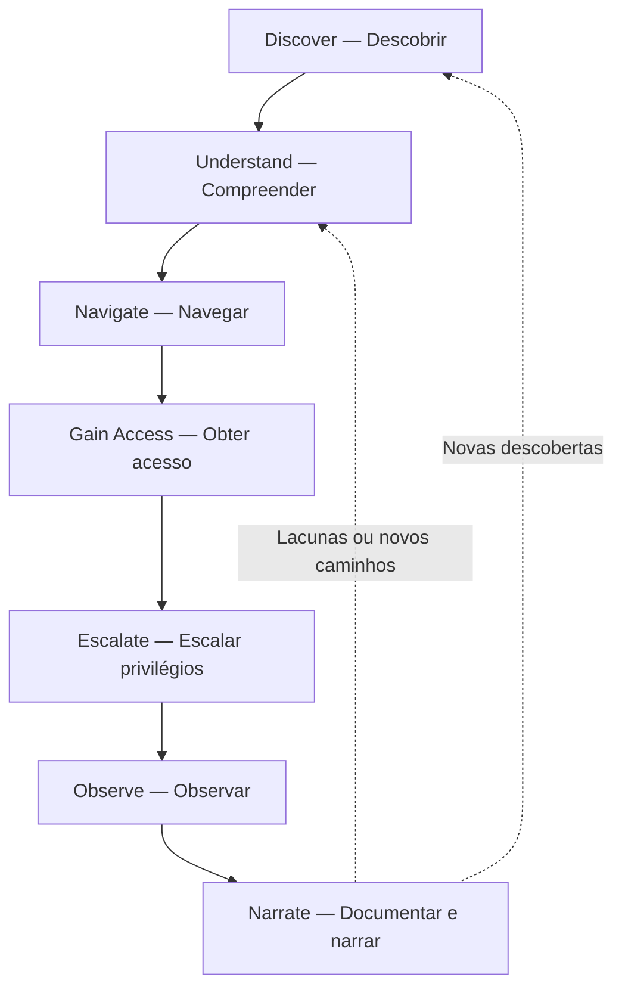

# 🗝️ Método DUNGEON
### Metodologia de Exploração e Análise Ofensiva

O **DUNGEON** é uma metodologia de estudo e execução de atividades de Segurança Ofensiva, concebida para estruturar a exploração de ambientes e desafios técnicos de forma consciente, progressiva e documentada.

Inspirado na exploração de uma dungeon — onde cada caminho, descoberta, obstáculo e recurso pode revelar novas possibilidades —, o método organiza uma jornada desde o reconhecimento inicial até a documentação dos resultados.

> **Descobrir o ambiente. Compreender seus mecanismos. Navegar pelos caminhos. Obter acesso. Escalar privilégios. Observar o impacto. Narrar a jornada.**

---

## 🧭 Etapas do método

O DUNGEON não deve ser interpretado como uma sequência rígida. Resultados inesperados, pistas adicionais ou caminhos bloqueados podem exigir revisitar etapas anteriores. O fluxo serve como orientação, não como roteiro inflexível.

---

## 1. Discover — Descobrir

### Objetivo
Reconhecer o ambiente e coletar informações iniciais para estabelecer o escopo e identificar possíveis pontos de interesse.

### Perguntas orientadoras
- Qual é o alvo e qual o escopo definido?
- Quais hosts, serviços, portas ou componentes estão visíveis?
- Que informações estão disponíveis antes de interagir mais profundamente?
- O que ainda não sabemos sobre o ambiente?

### Atividades comuns
- Reconhecimento inicial.
- Identificação de hosts e serviços.
- Enumeração preliminar de portas e tecnologias.
- Coleta e organização das informações públicas ou disponibilizadas pelo laboratório.

### Resultado esperado
Uma visão inicial do ambiente, com ativos, serviços, pistas e áreas que merecem investigação.

---

## 2. Understand — Compreender

### Objetivo
Interpretar as informações descobertas e entender o funcionamento, as características e possíveis fragilidades dos componentes identificados.

### Perguntas orientadoras
- O que esses serviços fazem?
- Como os componentes identificados se relacionam?
- Quais versões, configurações ou comportamentos são relevantes?
- Quais hipóteses podem explicar as oportunidades ou restrições observadas?

### Atividades comuns
- Enumeração mais aprofundada.
- Análise de serviços, aplicações e protocolos.
- Pesquisa de comportamentos e vulnerabilidades pertinentes.
- Identificação de possíveis vetores e validação de hipóteses com evidências.

### Resultado esperado
Um entendimento técnico do ambiente e uma lista fundamentada de caminhos potenciais a explorar.

---

## 3. Navigate — Navegar

### Objetivo
Explorar os caminhos identificados de maneira organizada, avaliando possibilidades, priorizando hipóteses e escolhendo abordagens de investigação ou exploração.

### Perguntas orientadoras
- Quais caminhos são viáveis diante das evidências?
- O que precisa ser validado antes de tentar avançar?
- Quais abordagens são pertinentes ao escopo e às condições do laboratório?
- O que aprendemos com caminhos que não funcionaram?

### Atividades comuns
- Priorização de vetores.
- Testes controlados de hipóteses.
- Análise de aplicações, serviços e configurações.
- Registro de caminhos explorados, resultados e obstáculos.

### Resultado esperado
Um caminho de exploração priorizado e sustentado pelas descobertas, incluindo alternativas e tentativas descartadas quando relevantes.

---

## 4. Gain Access — Obter acesso

### Objetivo
Validar e executar, dentro do escopo autorizado, um caminho que permita obter acesso inicial ao sistema ou componente alvo.

### Perguntas orientadoras
- Qual evidência sustenta este vetor?
- O que a exploração demonstra sobre a falha ou configuração?
- Que tipo de acesso foi obtido e com quais limitações?
- Como comprovar o resultado sem ultrapassar o escopo?

### Atividades comuns
- Exploração de vulnerabilidades ou configurações inseguras em ambientes autorizados.
- Validação do acesso inicial.
- Registro das condições, ferramentas e evidências que sustentam o resultado.

### Resultado esperado
Acesso inicial validado, com evidências e contexto suficientes para explicar como foi alcançado.

---

## 5. Escalate — Escalar privilégios

### Objetivo
Investigar as possibilidades de ampliar os privilégios ou capacidades disponíveis, quando isso fizer parte do objetivo e do escopo do desafio.

### Perguntas orientadoras
- Quais privilégios possuo atualmente?
- Quais configurações, permissões, serviços ou recursos podem permitir uma elevação?
- O que diferencia o acesso atual do nível de privilégio pretendido?
- A hipótese de elevação está sustentada por evidências?

### Atividades comuns
- Identificação do contexto de privilégios.
- Análise de permissões e configurações.
- Investigação de mecanismos de elevação pertinentes ao sistema.
- Validação controlada de caminhos de elevação.

### Resultado esperado
Elevação de privilégios validada, quando possível, e documentação das condições que permitiram — ou impediram — o avanço.

---

## 6. Observe — Observar

### Objetivo
Examinar o ambiente após o acesso e compreender o alcance, os resultados e as evidências relevantes da exploração.

### Perguntas orientadoras
- O que o acesso permite demonstrar?
- Quais informações ou recursos ficaram acessíveis?
- Quais evidências comprovam o resultado?
- Que riscos ou impactos essa condição poderia representar em um contexto real?
- Quais limites devem ser respeitados durante a atividade?

### Atividades comuns
- Verificação dos objetivos e flags do laboratório, quando aplicável.
- Análise de permissões e recursos acessíveis.
- Coleta de evidências técnicas.
- Avaliação do impacto potencial sem ações desnecessárias ou fora do escopo.

### Resultado esperado
Evidências que permitam demonstrar e explicar o resultado da exploração e seu possível impacto.

---

## 7. Narrate — Narrar

### Objetivo
Transformar a jornada técnica em um relato estruturado, reproduzível e útil para aprendizado, consulta e compartilhamento.

### Perguntas orientadoras
- Qual era o cenário?
- Quais etapas foram percorridas e por quê?
- Quais evidências sustentam cada descoberta?
- Quais caminhos falharam ou foram descartados e o que aprendemos?
- Como a vulnerabilidade ou configuração insegura poderia ser corrigida ou mitigada?

### Atividades comuns
- Organização das evidências e dos passos relevantes.
- Elaboração do relatório técnico.
- Registro de ferramentas, comandos, resultados e limitações.
- Explicação do vetor, impacto e mitigação.
- Consolidação dos aprendizados.

### Resultado esperado
Um write-up claro e tecnicamente fundamentado, que registre o caminho percorrido, permita compreender a solução e destaque os aprendizados e medidas de mitigação.

---

## 🔄 A jornada não é linear

O DUNGEON organiza a exploração, mas não impõe uma sequência inflexível.

Durante a jornada, uma descoberta pode mudar a compreensão do ambiente, invalidar uma hipótese ou abrir um caminho inesperado. Nesse caso, pode ser necessário retornar a **Discover**, **Understand** ou **Navigate**, reavaliar o cenário e seguir por uma nova rota.

O método valoriza a exploração orientada por evidências, não a execução mecânica de comandos.

---

## 🧠 Princípio de aprendizagem

Ao realizar uma atividade, não se limite a reproduzir comandos ou seguir um walkthrough. Procure compreender a lógica por trás de cada ação relevante.

Use estas perguntas para orientar o aprendizado:

- **O que fiz?**
- **Por que fiz?**
- **O que encontrei?**
- **O que isso demonstra?**
- **Como esse resultado se conecta ao próximo passo?**

Nem todo comando precisa ser detalhado no relatório. O foco está em compreender, registrar e explicar as decisões, técnicas e evidências que contribuíram para o avanço da exploração.

---

## 📝 Aplicação em laboratórios e CTFs

O DUNGEON pode ser aplicado em desafios de plataformas como TryHackMe e Hack The Box, em laboratórios próprios e em outros exercícios de Segurança Ofensiva realizados dentro de um escopo autorizado.

O relatório resultante deve ser mais do que uma lista de comandos: deve apresentar o cenário, as descobertas, o raciocínio, as evidências, a cadeia de exploração, os resultados e as possíveis mitigações.

---

## 🕸️ DUNGEON e TEIA

| Método | Foco | Propósito |
|---|---|---|
| **DUNGEON** | Segurança Ofensiva | Estruturar reconhecimento, compreensão, exploração, obtenção de acesso, elevação e documentação. |
| **TEIA** | Segurança Defensiva | Estruturar investigação, análise e correlação de evidências para reconstruir acontecimentos. |

Os dois métodos são complementares: compreender caminhos de exploração também pode enriquecer a análise defensiva, enquanto a capacidade de investigar e correlacionar evidências amplia a compreensão de ambientes e incidentes.

---

> **DUNGEON v1.0 — uma metodologia em evolução, aprimorada a partir da prática, dos desafios e dos aprendizados de cada jornada.**
