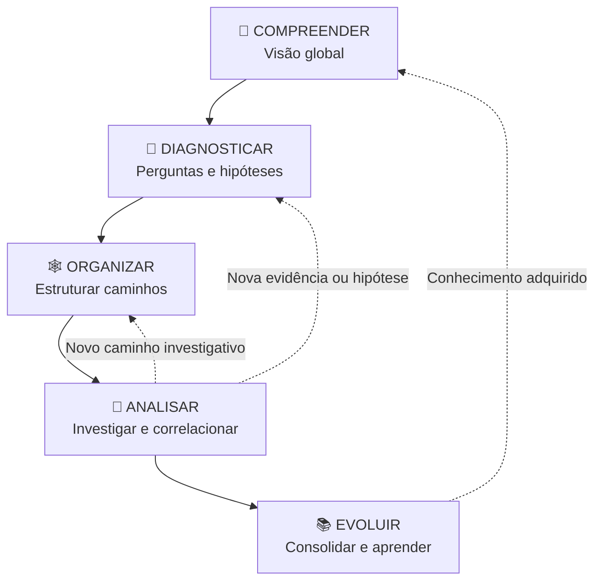

# 🕸️ Método TEIA
### Metodologia de Investigação e Análise de Evidências

O **Método TEIA** é uma abordagem estruturada para conduzir investigações em Segurança Defensiva, especialmente em laboratórios de Blue Team, Network Forensics, Endpoint Forensics, Malware Analysis, Threat Hunting e DFIR.

A metodologia parte de cinco princípios — **Compreender, Diagnosticar, Organizar, Analisar e Evoluir** — para transformar um cenário desconhecido em uma investigação orientada por perguntas, hipóteses, evidências e conclusões fundamentadas.

> **Observe o cenário. Identifique as pistas. Estruture os caminhos. Conecte as evidências. Reconstrua os acontecimentos.**

---

## 🧭 Os cinco princípios

| Etapa | Propósito | Resultado esperado |
|---|---|---|
| **1. Compreender** | Construir uma visão global do cenário, do artefato e do problema investigativo. | Contexto inicial e definição do problema. |
| **2. Diagnosticar** | Identificar pistas, questões, hipóteses, lacunas e prioridades. | Perguntas investigativas e hipóteses iniciais. |
| **3. Organizar** | Estruturar evidências, segmentos, ferramentas e caminhos de investigação. | Plano investigativo organizado. |
| **4. Analisar** | Examinar artefatos, testar hipóteses, correlacionar evidências e reconstruir eventos. | Evidências interpretadas e reconstrução fundamentada. |
| **5. Evoluir** | Consolidar resultados, documentar, identificar detecções e transformar a experiência em conhecimento. | Write-up, aprendizados e possíveis melhorias defensivas. |

---

## 1 — 🧭 Compreender

**Objetivo:** entender o cenário como um todo antes de mergulhar nos artefatos.

Perguntas orientadoras:

- O que aconteceu ou o cenário sugere que aconteceu?
- Qual artefato ou conjunto de artefatos está disponível?
- Qual é o contexto e o escopo do laboratório?
- O que preciso descobrir?
- O que já sei e o que ainda é desconhecido?

Atividades possíveis:

- Ler e interpretar o briefing.
- Identificar o tipo, origem e formato dos artefatos.
- Compreender o contexto e o escopo.
- Reconhecer fontes de evidência e ferramentas potencialmente úteis.
- Estabelecer uma visão inicial do cenário.

**Entregável:** visão geral do caso e definição inicial do problema investigativo.

---

## 2 — 🔎 Diagnosticar

**Objetivo:** decompor o cenário em questões investigáveis, identificar pistas e levantar hipóteses.

Perguntas orientadoras:

- Quais elementos chamam atenção?
- Quais hosts, usuários, processos, arquivos, endereços ou eventos podem estar envolvidos?
- Quais hipóteses poderiam explicar o cenário?
- Quais informações estão faltando?
- O que deve ser investigado primeiro?
- O que pode ser relevante e o que pode ser ruído?

Atividades possíveis:

- Identificar pistas e indicadores potencialmente relevantes.
- Formular hipóteses iniciais.
- Dividir o cenário em segmentos ou questões menores.
- Identificar lacunas de informação.
- Priorizar caminhos investigativos.
- Definir perguntas que orientarão a análise.

**Entregável:** questões investigativas, hipóteses iniciais e caminhos priorizados.

---

## 3 — 🕸️ Organizar

**Objetivo:** estruturar os caminhos da investigação, as evidências disponíveis e os recursos necessários.

Perguntas orientadoras:

- Quais evidências já tenho?
- Como os elementos se relacionam?
- Em que sequência faz sentido investigar?
- Quais ferramentas e técnicas podem responder às perguntas levantadas?
- Quais fontes precisam ser correlacionadas?
- Como registrar os resultados para preservar contexto?

Atividades possíveis:

- Separar artefatos por tipo ou fonte.
- Organizar hipóteses, perguntas e evidências.
- Definir uma sequência de análise, quando possível.
- Selecionar ferramentas e técnicas adequadas.
- Registrar descobertas, referências e caminhos percorridos.
- Preparar uma estrutura que permita revisitar a investigação.

A organização deve ser proporcional à complexidade do caso: não é necessário criar planilhas ou estruturas elaboradas para todo laboratório.

**Entregável:** estrutura e plano investigativo com caminhos definidos e evidências organizadas.

---

## 4 — 🧩 Analisar

**Objetivo:** examinar evidências, testar hipóteses, estabelecer relações e reconstruir os acontecimentos.

Perguntas orientadoras:

- O que esta evidência demonstra?
- A hipótese foi confirmada, refutada ou permanece inconclusiva?
- O que este artefato revela?
- Existem relações entre eventos, fontes ou artefatos?
- O que aconteceu antes e depois?
- As evidências sustentam a conclusão?
- Que outros caminhos surgiram a partir desta descoberta?

Atividades possíveis:

- Análise de PCAPs e protocolos.
- Análise de logs.
- Análise de processos, arquivos e artefatos de endpoint.
- Investigação de DNS, HTTP, TCP e outros protocolos.
- Extração e validação de artefatos.
- Análise de hashes e metadados.
- Correlação entre fontes de evidência.
- Teste, refinamento e refutação de hipóteses.
- Reconstrução da sequência de acontecimentos.

**Princípio:** comandos e ferramentas são meios para responder perguntas investigativas — não objetivos isolados.

**Entregável:** evidências examinadas, hipóteses testadas, relações identificadas e uma reconstrução fundamentada.

---

## 5 — 📚 Evoluir

**Objetivo:** consolidar os resultados e transformar a investigação em conhecimento reutilizável.

Perguntas orientadoras:

- O que consegui reconstruir?
- Quais evidências sustentam minhas conclusões?
- O que aprendi?
- Como o comportamento poderia ser detectado em um ambiente real?
- Quais controles poderiam prevenir ou reduzir o impacto?
- O que ainda preciso estudar?
- Como documentar os resultados de forma útil para outras pessoas?

Atividades possíveis:

- Consolidar resultados e conclusões.
- Documentar a investigação em um write-up.
- Catalogar IoCs, quando aplicável.
- Identificar mecanismos e oportunidades de detecção.
- Levantar recomendações defensivas.
- Relacionar comportamentos a frameworks como MITRE ATT&CK, quando pertinente.
- Registrar limitações, dificuldades e aprendizados.
- Identificar novos caminhos de estudo.

**Entregável:** relatório técnico, conhecimento consolidado, oportunidades de aplicação defensiva e próximos passos.

---

## 🔄 Uma investigação não é linear

O Método TEIA orienta o processo, mas não exige uma sequência rígida. Durante a análise, uma evidência pode mudar a compreensão do caso, revelar uma lacuna ou abrir um novo caminho.

É possível retornar ao Diagnóstico, reorganizar os caminhos ou rever a compreensão inicial. A investigação deve acompanhar as evidências, e não se prender a um roteiro inflexível.

---

## 💡 Princípio de aprendizagem

Durante os laboratórios, procure compreender não apenas **o que** foi executado, mas também:

- **O que fiz?**
- **Por que fiz?**
- **O que encontrei?**
- **O que isso significa?**
- **Como isso se conecta ao restante da investigação?**

Nem todo comando precisa virar uma longa explicação no relatório. Entretanto, as técnicas relevantes devem ser compreendidas, e não apenas reproduzidas.

---

## 🧪 Exemplo de aplicação

Em um laboratório de Network Forensics, o método pode ser aplicado assim:

| Etapa | Exemplo |
|---|---|
| **Compreender** | Interpretar o cenário, o PCAP disponível e os objetivos da investigação. |
| **Diagnosticar** | Definir perguntas: quais hosts se comunicaram, quais serviços foram acessados, quais arquivos foram entregues e quais eventos podem ser reconstruídos? |
| **Organizar** | Separar caminhos de investigação: fluxos, HTTP, DNS, extração de objetos e análise de artefatos. |
| **Analisar** | Examinar o tráfego, extrair evidências, validar hashes, testar hipóteses e correlacionar informações. |
| **Evoluir** | Documentar o caso, catalogar IoCs, identificar possibilidades de detecção e registrar aprendizados. |

---

## ⚖️ TEIA e DUNGEON

| Metodologia | Área | Orientação |
|---|---|---|
| **DUNGEON** | Segurança Ofensiva | Estruturar reconhecimento, exploração, acesso, pós-exploração e documentação. |
| **TEIA** | Segurança Defensiva | Estruturar investigação, análise, correlação de evidências, reconstrução e aprendizado. |

As metodologias possuem objetivos diferentes e complementares: compreender técnicas de ataque e desenvolver capacidade de investigar seus rastros.

---

*O Método TEIA é uma metodologia de estudo e investigação em evolução, refinada a partir da prática em laboratórios e cenários investigativos.*
